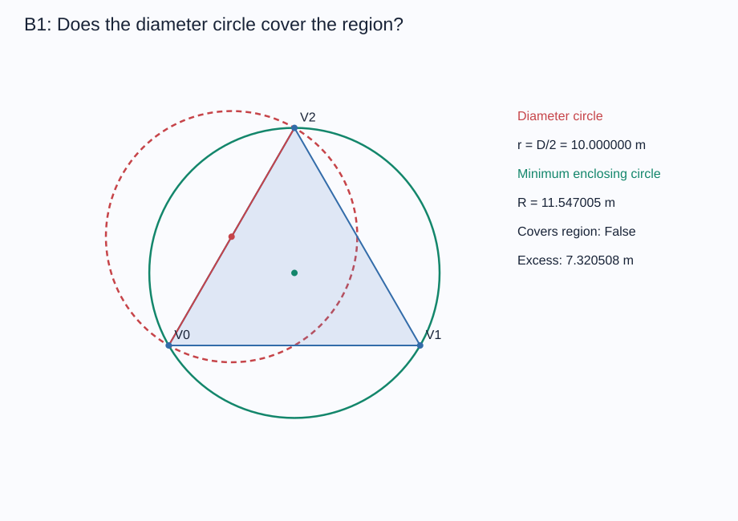

# B 题问题一：多边形定位区域直径与圆覆盖检验

## 结论

**以定位区域直径为直径的圆，不一定能覆盖该定位区域；即使允许任意选择圆心，也不能保证覆盖。**

本程序采用「示向度角域的半平面交集 → 凸包排序 → 旋转卡壳求直径 → 顶点圆覆盖检验」，并另外计算最小包围圆进行交叉核验。已通过 6 项单元测试、150 组随机凸包直径核验及 400 组模拟测向算例，其中 20 组最小包围圆另外用凸优化独立核验。

题面来源：`D:/CUMCM2026Problems/B题/B题.pdf`，问题一及附录 2 第 (1)、(3) 条。题面没有给出问题一的具体检测点坐标表，以下数据为自行构造或按明确规则生成的算例，不是模拟器的演练或正式测试日志。

## 1. 定位区域模型

题面采用东向为 x 轴正向、北向为 y 轴正向，方位角从 x 轴正向逆时针计量，测向误差范围为 ±1°。设第 i 个检测点为 S_i=(x_i,y_i)，示向度为 θ_i，取 ε=1°，定义

\[
u_i^-=(\cos(\theta_i-\varepsilon),\sin(\theta_i-\varepsilon)),\qquad
u_i^+=(\cos(\theta_i+\varepsilon),\sin(\theta_i+\varepsilon)).
\]

令二维叉积 a×b=a_x b_y-a_y b_x。干扰源位置 X 必须满足

\[
u_i^-\times(X-S_i)\ge0,\qquad
u_i^+\times(X-S_i)\le0.
\]

因此 n 个检测点给出的定位区域为

\[
P=\bigcap_{i=1}^n\{X:u_i^-\times(X-S_i)\ge0,\ u_i^+\times(X-S_i)\le0\}.
\]

每个角域是两个闭半平面的交集，P 是凸集。以上不等式保留了检测点前方的角域，不能用无向直线的交会代替，也无需对 0°/360° 单独分类。

**建模边界：**这里计算附录 2 图 2 定义的「示向度角域交会多边形」。不把 1800 米目标圆域或接收距离圆盘加入计算；加入这些先验后，区域可能包含圆弧，不能继续声称是同一个多边形。程序也没有用任意大矩形截断角域。若角域交集无界，会明确返回 `unbounded`。下文的三角形和四边形反例都位于目标圆域内，加入该目标圆域不会改变反例结论。

## 2. 区域求交与直径算法

将上述约束写为 AX≤b，共 m=2n 行，法向量归一化为长度 1。

1. 用线性规划检查可行性；无可行点返回 `empty`。
2. 分别求 x、-x、y、-y 的最小值。任意一个方向无界，则区域无界，无法定义有限直径。
3. 枚举两条非平行边界直线的交点，保留满足全部约束的交点。
4. 用 Andrew 单调链凸包算法去除重复点及边上的冗余点，得到逆时针顶点序列 V_0,…,V_(h-1)。
5. 用旋转卡壳枚举对踵点，计算最大距离 D，并保留一对最远顶点 A、B。

为何只需检查顶点？若 X=Σ_i α_i V_i，Y=Σ_j β_j V_j，其中权重非负且分别求和为 1，则

\[
\|X-Y\|=\left\|\sum_{i,j}\alpha_i\beta_j(V_i-V_j)\right\|
\le\sum_{i,j}\alpha_i\beta_j\|V_i-V_j\|
\le\max_{i,j}\|V_i-V_j\|.
\]

故区域直径恰好为最远顶点间距。固定一条边时，最远支撑点可由面积最大化确定；随着边沿凸包旋转，该支撑点只向前移动，旋转卡壳总复杂度为 O(h)。

当前求交实现适合检测点数量较少的场景：枚举交点并检查约束为 O(m³)，凸包排序最多 O(m² log m)。本实现优先采用易审查、易验证的求交算法；若检测点达到数千个，可将该步骤替换为按极角排序的半平面交算法。

## 3. 同直径圆覆盖的充要判据

取任意一对最远顶点 A、B，令

\[
C=(A+B)/2,\quad r=D/2.
\]

**判据：存在直径为 D 的圆盘覆盖 P，当且仅当所有顶点都满足 ||V_i-C||≤D/2。**

证明分两步：

* 若半径 D/2、圆心 O 的圆盘同时包含 A、B，则 D=||A-B||≤||A-O||+||O-B||≤D。等号强制 O 在 AB 上，且到两端距离均为 D/2，因此 O=C。也就是说，想覆盖区域的同直径圆，圆心已经由任意一对最远点唯一确定，移动圆心无法补救。
* 圆盘是凸集，包含所有多边形顶点就包含其凸包，即整个 P。反之，任何顶点在圆外便构成不可覆盖的证据。

因此是对整个连续区域的判定，不是采样内部点后的经验猜测。覆盖检查为 O(h)，程序同时输出最远圆外顶点及其超出半径的距离。

对最小包围圆，程序枚举由单顶点、两顶点中点或三顶点外心确定的候选圆，验证是否包含全部顶点，取最小者。复杂度 O(h⁴)，用于小规模多边形的独立核验；它不是前述覆盖判定的必要步骤。若顶点数量很大，可替换为随机增量最小包围圆算法。

浮点计算使用距离容差 10⁻⁷ 米。极近于平行、尺度远大于题面或小于该容差的数据应重新缩放或改用高精度计算；当前输出是带容差的数值结果。

## 4. 确定性反例：三次测向得到等边三角形

以下检测点及示向度采用题面的坐标、角度定义，误差半宽均为 1°：

| 检测点 | x / 米 | y / 米 | 示向度 / 度 |
|---|---:|---:|---:|
| S₁ | 500 | 877.5724091682313 | 241 |
| S₂ | -1010 | -5.773502691896258 | 1 |
| S₃ | 510 | -871.7989064763350 | 121 |

其角域交集为顶点

\[
(0,20/\sqrt3),\quad(-10,-10/\sqrt3),\quad(10,-10/\sqrt3)
\]

组成的等边三角形，边长即区域直径 D=20 米。构造方法是沿每条逆时针边的反方向延伸 1000 米设置检测点，使示向度下边界恰为该边，上边界对三角形是冗余约束。

取真实干扰源 G=(0,0)，其方向均落在对应 ±1° 角域内；检测点到 G 距离约 1000 米，可选择 1200 米有效接收半径，符合题面 1000～1500 米条件，且不存在 5 米内无法测向的问题。

| 指标 | 理论值 | 程序结果 / 米 |
|---|---|---:|
| 区域直径 D | 20 | 20.000000000001 |
| 同直径圆半径 | 10 | 10.000000000000 |
| 第三顶点到任意一边中点距离 | 10√3 | 17.320508075689 |
| 第三顶点超出同直径圆的距离 | 10(√3−1) | 7.320508075689 |
| 最小包围圆半径 R | 20/√3 | 11.547005383793 |
| 最小覆盖圆直径 2R | 40/√3 | 23.094010767586 |

所以即使重新选择圆心，覆盖圆的直径也至少为 23.0940 米，不能只取 20 米。



## 5. 两个检测点的四边形反例

随机实验还找到下列两次检测数据，真实干扰源同样取原点，测向误差均在 ±1° 内：

| 检测点 | x / 米 | y / 米 | 示向度 / 度 |
|---|---:|---:|---:|
| S₁ | -685.3747323342595 | -477.3694538026680 | 34.22321206958426 |
| S₂ | -293.9167166686227 | 430.8299229978883 | 304.0378678286391 |

定位区域为四边形，完整顶点保存在 `results/two_station_counterexample.json`。

| 指标 | 结果 / 米 |
|---|---:|
| 区域直径 D | 34.514803333761 |
| 同直径圆半径 D/2 | 17.257401666880 |
| 最远顶点到该圆心距离 | 17.763499396997 |
| 超出半径的距离 | 0.506097730116 |
| 最小包围圆半径 R | 17.266060715982 |

此例与题面图 2 相同，使用两个检测点形成四边形，仍不能由直径 D 的圆盘覆盖。圆心移动后最小包围圆有所改善，但所需直径仍为 34.532121431965 米，大于区域直径。

## 6. 对照例与随机实验

可覆盖对照例：检测点 (-1000,0)、(0,-1000)，示向度分别为 0°、90°。其定位四边形直径为 49.385425823734 米，最小包围圆半径为 24.692712911867 米，等于 D/2，覆盖检验为真。

随机实验固定种子为 20260910，真实干扰源为 (0,0)；检测点数在 2～6 个之间轮换，各 80 组。每个检测点的极角均匀抽取，距原点距离均匀抽取自 [200,1000] 米；在真实方向上添加 [-1°,1°] 均匀误差。该实验满足题面误差界，均匀分布是实验设计，不是题面给出的统计假设。不同算例独立模拟，不涉及在同一地点重复检测。

| 检测点数 | 可覆盖 | 不可覆盖 | 角域交集无界 |
|---:|---:|---:|---:|
| 2 | 78 | 1 | 1 |
| 3 | 58 | 22 | 0 |
| 4 | 62 | 18 | 0 |
| 5 | 58 | 22 | 0 |
| 6 | 53 | 27 | 0 |
| 合计 | 309 | 90 | 1 |

399 组有界算例中，90 组不覆盖，占 22.56%。该比例仅描述当前采样方案，不能解释为实际任务中的通用失败概率。确定性反例已足够否定「总能覆盖」，随机实验用于验证实现及说明现象并非只出现在等边三角形中。

验证结果：

* 6 项单元测试全部通过，覆盖确定性正反例、空集、无界集、点/线段退化、角度跨零和前向约束。
* 150 组随机凸包及平行边正方形的旋转卡壳结果均与全部顶点对穷举结果一致。
* 400 组测向算例均核验真实源可行性；全部有界结果均核验顶点满足半平面约束，且旋转卡壳直径与穷举一致。
* 全部有界算例的「同直径圆覆盖」结果均与最小包围圆条件 R≤D/2 一致。
* 20 组最小包围圆与独立凸优化结果的半径误差小于 10⁻⁵ 米。

## 7. 对后续模型的意义

可以用区域直径衡量定位不确定性，但不应直接把 D/2 当成保证覆盖的半径。若要选择一个位置，使其到所有可能源位置均不超过给定距离，应求最小包围圆及其圆心。

平面上有 D/2≤R≤D/√3。下界由最远点对得到；若最小包围圆由三个点支撑，则圆心在其三角形内，三个相邻圆心角均不超过 180°、和为 360°，其中至少一个不小于 120°，对应弦长至少为 √3R，因此 D≥√3R；由两个点支撑时 R=D/2。等边三角形达到上界。这也解释了最坏情况下所需最小覆盖圆直径可比区域直径大约 15.47%。

## 8. 运行与文件

依赖：Python 3、NumPy、SciPy。本次使用系统 Python 3.13，NumPy 2.4.6、SciPy 1.17.1。

在本目录运行：

```powershell
python -X utf8 b1_coverage.py --self-test --demo --trials 400
python -X utf8 b1_coverage.py --input results/equilateral_counterexample_input.json --output results/custom_result.json
```

自定义输入 JSON 格式：

```json
{
  "error_deg": 1.0,
  "observations": [
    {"x": -1000, "y": 0, "bearing_deg": 0},
    {"x": 0, "y": -1000, "bearing_deg": 90}
  ]
}
```

输出包含 `status`；有界时还包含区域顶点、区域直径、最远点对、同直径圆心和半径、覆盖布尔值、圆外证据顶点、最小包围圆及支撑点。无界和空集不会输出伪造的有限直径。

* `b1_coverage.py`：通用计算程序、测试及示例生成。
* `results/*_input.json`：可直接复现的输入。
* `results/*.json`：各算例结果及随机实验统计。
* `results/*.svg`：几何示意图，红色虚线为同直径圆，绿色实线为最小包围圆。
