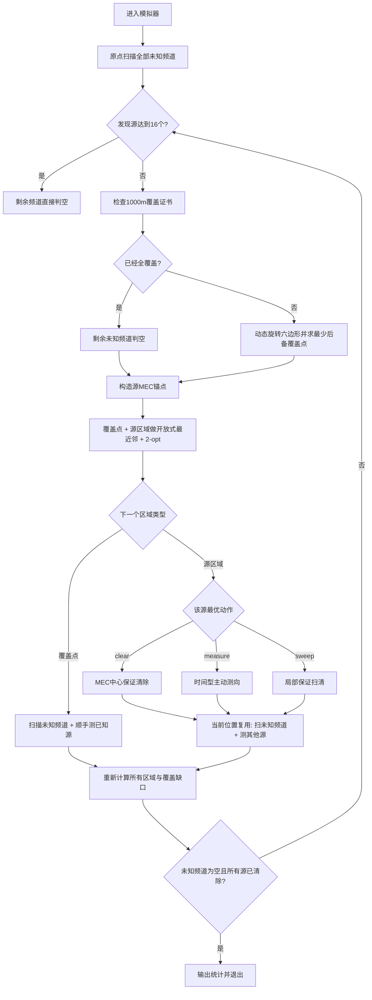

# 问题 3 机器狗自动搜索、定位与清除算法说明

> 对应代码：`problem3_robot_optimized_v2(1).py`
>
> 本文档说明该程序的整体算法设计、关键几何模型、搜索与定位策略、时间优化思路，以及各模块之间的配合关系。

---

## 1. 算法目标

程序需要控制机器狗在半径为 `1800 m` 的圆形场地中，对多个频道进行搜索，并对存在的全向干扰源完成：

1. **发现干扰源**：保证所有可能存在的频道都不会漏检；
2. **定位干扰源**：利用带有 `±1°` 误差的测向信息逐步缩小源的位置可行域；
3. **清除干扰源**：当可以保证机器狗距离真实源不超过 `20 m` 时执行清除；
4. **最小化总虚拟时间**：重点降低移动时间，同时减少无价值测量、频道切换和重复路径。

程序最终采用的不是传统的“搜索完全部频道 → 再逐个定位 → 最后清除”的严格三阶段结构，而是：

> **搜索、定位、清除交织执行，并让同一个访问位置尽可能同时完成多种任务。**

主入口为：

```python
Problem3Controller.run()
    -> interleaved_search_localize_clear()
```

---

## 2. 核心设计思想

整套算法可以概括为五句话：

1. 用严格的 **1000 m 全场覆盖证书** 保证搜索完整性；
2. 用多个角域、距离约束和 `signal / no_signal` 信息维护真实源的 **保守可行域**；
3. 用最小包围圆判断是否已经能够 **保证清除**；
4. 主动测点不只追求几何最优，而是直接估计 **虚拟时间成本**；
5. 把搜索点、定位点和清除点放进同一个路线规划问题中，尽量做到 **一次移动，多次利用**。

因此，本程序的重点不是某一个单独的几何算法，而是：

> **“严格正确性约束 + 主动定位 + 路线优化 + 多任务位置复用”的联合策略。**

---

## 3. 重要参数

| 参数 | 含义 | 默认值 |
|---|---:|---:|
| `ARENA_R` | 场地半径 | `1800 m` |
| `MIN_RECEIVE_R` | 保证能够收到信号的距离 | `1000 m` |
| `MAX_RECEIVE_R` | 收到方向信号时的最大距离约束 | `1500 m` |
| `BEARING_ERR_DEG` | 测向角误差 | `±1°` |
| `NEAR_R` | 返回 `near` 的距离 | `5 m` |
| `CLEAR_R` | 清除半径 | `20 m` |
| `READY_RADIUS` | 进入保证清除状态的 MEC 半径 | `19 m` |
| `COVER_RING_R` | 7 点覆盖外圈半径 | `1140 m` |
| `COARSE_STEP` | 主动定位粗网格步长 | `125 m` |
| `FINE_STEP` | 主动定位精网格步长 | `30 m` |
| `MIN_ACTIVE_BASELINE` | 两次主动测向的最小基线 | `80 m` |
| `MOVE_SPEED_MPS` | 虚拟移动速度 | `5 m/s` |
| `MEASURE_ACTION_S` | 一次测量动作时间 | `5 s` |
| `SWITCH_CHANNEL_S` | 换频道时间 | `1 s` |
| `CLEAR_ACTION_S` | 成功清除动作时间 | `5 s` |

其中最重要的一点是：

```text
移动 500 m ≈ 100 s
一次测向 ≈ 5 s
```

因此，在优化目标中，**减少无意义移动往往比减少一两次测量更重要**。

---

## 4. 数据结构

### 4.1 单次观测 `Observation`

```python
@dataclass
class Observation:
    pos: Point
    svd_deg: float
```

记录：

- 测量位置；
- 返回的测向角。

### 4.2 干扰源状态 `SourceState`

每个已发现频道维护：

```text
channel        频道编号
poly           当前保守可行多边形
observations   历史有效方向观测
cleared        是否已经清除
clear_attempts 清除尝试次数
```

另外可以实时计算：

- `diameter`：当前可行域直径；
- `mec`：当前可行域最小包围圆；
- `ready`：最小包围圆半径是否 `<= 19 m`。

---

# 5. 保守可行域模型

## 5.1 为什么维护“区域”而不是一个估计点

每次测向都有 `±1°` 的误差，因此不能直接把多条射线求交后得到一个点作为真实位置。

程序始终维护一个集合：

\[
P_k \supseteq \{G_{\text{true}}\}
\]

即：

> 当前多边形 `P_k` 必须始终包含真实干扰源。

只要这一性质不被破坏，后续基于最小包围圆的“保证清除”就是安全的。

---

## 5.2 初始场地区域

真实场地为圆盘：

\[
\|G\|\le 1800.
\]

程序用一个**圆的外接正 180 边形**表示它。

因为使用的是外接多边形，所以：

\[
\text{真实圆盘}\subseteq \text{外接多边形}.
\]

这是一种保守近似，不会误删真实位置。

---

## 5.3 `direction` 返回后的角楔约束

若机器狗在位置 `S` 测得方位角：

\[
\theta
\]

测向误差为 `±1°`，则真实源必须位于：

\[
\theta-1^\circ \le \angle(SG)\le \theta+1^\circ.
\]

这对应一个二维角楔。

程序通过两次半平面裁剪实现：

```python
clip_wedge(poly, station, measured_deg)
```

底层使用 Sutherland-Hodgman 多边形裁剪。

---

## 5.4 `direction` 对应的距离约束

如果返回的是 `direction`，则还可以利用两条距离信息。

### 约束 1：距离大于 5 m

因为距离 `<=5 m` 时会返回 `near`，所以 `direction` 意味着：

\[
d(S,G)>5.
\]

代码将其转换成沿测向中心方向的保守线性约束。

### 约束 2：距离不超过 1500 m

测得方向意味着源还在最大接收范围内：

\[
d(S,G)\le1500.
\]

程序仍采用圆的外接正多边形进行裁剪，从而保证真实圆盘不会被错误删除。

因此一次方向观测后的区域近似为：

\[
P_{k+1}
=
P_k
\cap W(S,\theta,1^\circ)
\cap D_{\text{forward}}>5
\cap B(S,1500).
\]

---

# 6. `no_signal` 信息的利用

这是本版本相对简单测向算法的重要优化之一。

很多程序会直接把 `no_signal` 当成“没有信息”，但问题 3 中全向源的有效接收半径对同一个源是固定的，因此：

- 在点 `S` 能收到信号；
- 在点 `N` 收不到信号；

说明存在某个有效半径 `R` 满足：

\[
|G-S|\le R<|G-N|.
\]

所以一定有：

\[
|G-S|<|G-N|.
\]

两边平方：

\[
|G-S|^2<|G-N|^2.
\]

展开二次项后，`G_x^2+G_y^2` 会相消，最终得到一个**线性半平面约束**。

几何意义非常直观：

> 真实源一定在 `S` 和 `N` 的垂直平分线靠近 `S` 的一侧。

因此程序保存历史 `no_signal` 点，在之后某处收到信号时，可以“免费”缩小可行域。

这使得搜索阶段的失败测量也能够服务于定位。

---

# 7. 最小包围圆与保证清除

对当前保守可行多边形 `P`，程序求它的最小包围圆：

\[
C(O,r)=\operatorname{MEC}(P).
\]

只要：

\[
r\le19\text{ m},
\]

就说明任意可能的真实源位置都满足：

\[
|G-O|\le19<20.
\]

因此在圆心 `O` 执行 `/clear`，一定处于 `20 m` 清除范围内。

代码特意使用 `19 m` 而不是 `20 m`，留下约 `1 m` 的数值安全余量。

最小包围圆使用随机增量式算法实现，思想与 Welzl / Nayuki 实现相近。

---

# 8. 搜索完整性：1000 m 全域覆盖证书

## 8.1 为什么需要覆盖证书

程序不能因为“若干点都没有检测到频道”就直接认为该频道不存在。

只有当整个场地内任一点距离至少一个搜索站不超过 `1000 m` 时，才能保证：

> 如果这个频道真的存在，就一定至少在一个搜索站收到过信号。

定义扫描点集合为：

\[
S=\{s_1,s_2,\ldots,s_n\}.
\]

覆盖半径：

\[
R_{\rm cover}
=
\max_{x\in\Omega}
\min_i \|x-s_i\|.
\]

若：

\[
R_{\rm cover}\le1000,
\]

则所有仍未发现的频道都可以严格判空。

---

## 8.2 7 点基本覆盖骨架

基础方案为：

- 圆心 1 个点；
- 半径 `1140 m` 的圆周上均匀放置 6 个点；
- 相邻外圈点夹角 `60°`。

形式为：

\[
S_0=(0,0),
\]

\[
S_k=1140
\begin{bmatrix}
\cos(\phi+60^\circ k)\\
\sin(\phi+60^\circ k)
\end{bmatrix},
\quad k=0,\dots,5.
\]

其中 `φ` 可以旋转，以降低整体路线长度，而不会破坏几何覆盖结构。

---

## 8.3 覆盖半径的严格计算

程序没有仅用密集网格采样判断覆盖，而是构造 Voronoi 意义下的极值候选点。

“到最近搜索站的距离”在圆形场地上的最大值只可能出现在：

1. 三个搜索站的 Voronoi 顶点；
2. 两站垂直平分线与场地圆周的交点；
3. 某搜索站对应 Voronoi 圆弧上的极值点；
4. 若干退化情况下的圆心和轴向边界点。

程序枚举这些点，并计算：

\[
\min_i d(x,s_i).
\]

取最大值得到严格覆盖证书。

这比单纯采样更可靠，因为采样可能漏掉真正的最坏位置。

---

# 9. 动态后备覆盖

程序虽然保留 7 点覆盖骨架作为安全后备，但当前主流程并不会机械地把 7 个点全部走完。

原因是：

> 定位点、清除点本身也可能成为新的扫描点。

如果机器狗已经为了定位某个源移动到了一个新位置，那么只需在该位置顺手扫描仍未知的频道，就可以把这个点加入搜索覆盖集合。

于是原本的某些 7 点骨架站可能已经不再需要。

---

## 9.1 最少补点原则

给定已经访问过的扫描点 `visited`，程序枚举外圈最多 6 个后备点的子集：

\[
C\subseteq \{S_1,\ldots,S_6\}.
\]

寻找最小的：

\[
|C|
\]

使：

\[
R_{\rm cover}(visited\cup C)\le1000.
\]

因为外圈只有 6 个点，最多只需枚举：

\[
2^6=64
\]

种组合，成本很小。

---

## 9.2 动态旋转六边形

更进一步，程序并不固定一个 `φ`。

每次重新规划时枚举：

```text
φ = 0°, 5°, 10°, ..., 55°
```

对每一个旋转角：

1. 找到能够补齐 1000 m 覆盖的最少后备点；
2. 如果多个方案需要的补点数量相同，则选择与剩余源联合路线最短的方案。

因此优化目标是分层的：

```text
第一优先级：补点数量最少
第二优先级：整体移动路线最短
```

覆盖正确性仍由 `guaranteed_cover_radius()` 做最终验证。

---

# 10. 主动定位点选择

当某个源尚未达到可清除精度时，需要选择下一次测向位置。

本程序不是简单选择“夹角最接近 90°”的位置，而是使用：

> **粗网格搜索 → 几何粗筛 → 最坏角域预测 → 虚拟时间评分 → 局部精网格优化。**

---

## 10.1 候选点必须满足保证接收

一个点 `q` 只有在当前整个保守可行域都位于其 `1000 m` 范围内时，才被认为是可靠主动测点：

\[
\max_{G\in P} d(q,G)\le1000.
\]

由于 `P` 是凸多边形，最远距离会在顶点取得，因此只需检查所有顶点。

这就是：

```python
robust_receive(q, state.poly)
```

这样可以保证主动移动到 `q` 后，不会出现“辛苦走过去却收不到信号”的情况。

---

## 10.2 最小测向基线

新测点还应尽量与历史观测点保持：

\[
d(q,S_i)\ge80\text{ m}.
\]

避免两次测向位置几乎重合，造成交会角太小、信息增益很差。

---

## 10.3 几何粗筛指标

程序先使用一个类似问题 2 的 U 型几何指标：

\[
U(q,G)
=
\frac{d(S_1,G)d(q,G)}{|\sin\gamma|},
\]

其中：

- `S1` 为第一次观测点；
- `q` 为候选新测点；
- `γ` 为两条观测方向在真实源处的夹角。

取当前可行域采样点上的最坏值：

\[
U(q)=\max_{G\in P}U(q,G).
\]

该指标主要用于快速删除明显不好的候选，而不是作为最终目标函数。

---

## 10.4 最坏后验直径预测

对保留下来的候选点 `q`，程序进一步预测：

> 如果真实源在当前可行域不同位置，并且下一次测向误差恰好取 `-1°、0°、+1°`，新的可行域最坏会有多大？

算法为：

```text
for 当前可行域中的代表性真实点 G:
    求 q -> G 的真实方位角
    for e in {-1°, 0°, +1°}:
        用 “真实方位角 + e” 对当前区域做角楔裁剪
        计算裁剪后多边形直径
取所有情况中的最大直径
```

记为：

\[
D_{\rm pred}(q).
\]

它近似表示“在 q 再测一次后的最坏剩余不确定度”。

需要强调：

> 这个预测只用于选点，不用于更新真实可行域，因此预测近似不会破坏最终定位的保守性。

---

# 11. 直接按虚拟时间选点

这是该版本最重要的性能优化之一。

如果只追求最小的后验直径，很容易选到很远的位置。

但移动速度只有 `5 m/s`，因此远走几百米可能浪费几十乃至上百秒。

程序把所有主要因素统一换成“秒”进行评分。

对候选点 `q`：

\[
T(q)
=
\frac{d(X_{cur},q)}{5}
+5
+w_c\frac{d(q,O_{MEC})}{5}
+0.85\frac{D_{pred}(q)}{5}.
\]

其中：

- 第一项：移动到新测点的时间；
- 第二项：执行测量的 5 秒；
- 第三项：测量后距离当前源区域中心的位置成本；
- 第四项：剩余定位不确定性对应的未来成本。

前两次观测时，代码会更强地鼓励机器狗向源区域中心推进，以减少早期出现大跨度 V 形折返。

---

## 11.1 精度下限约束

为了防止“只顾近，不顾测量质量”，程序同时保留质量门槛。

假设所有候选中的最优预测直径为：

\[
D^*.
\]

则：

- 前两次观测允许：`D_pred <= 1.50 D*`；
- 第三次及以后要求：`D_pred <= 1.18 D*`。

也就是说：

> 早期可以多牺牲一点几何精度换路线，后期必须更接近几何最优，保证定位能够收敛。

---

## 11.2 粗到精搜索

### 第一层：粗网格

步长：

```text
125 m
```

流程：

1. 生成候选；
2. 删除不能保证接收的点；
3. 删除基线过短的点；
4. 用几何指标粗筛；
5. 强制补入“离当前最近”“离 MEC 中心最近”的若干点；
6. 对剩余点做最坏直径和虚拟时间精评估。

### 第二层：局部精网格

以粗网格最优点为中心，在附近重新建立：

```text
30 m
```

步长的局部网格，再进行同样的评估。

这种方法比直接在整个二维区域做 30 m 网格搜索快很多。

---

# 12. 同点复用：一次移动服务多个源

机器狗到达某个位置后，移动成本已经支付。

此时对其他频道补一次测量，只需要：

```text
约 5 s 测量 + 最多 1 s 换台
```

因此程序会检查当前点是否还能高价值地服务其他已知源。

对某个其他源计算：

\[
r=
\frac{D_{pred}}{D_{current}}.
\]

若预测缩域足够明显，则顺手测量。

这样可以避免：

```text
到 A 点只测源1
再移动到 B 点测源2
再移动到 C 点测源3
```

而变成：

```text
到 A 点
├─ 主测源1
├─ 顺手测源2
└─ 顺手测源3
```

这是降低平均每个干扰点耗时的关键策略之一。

---

# 13. 搜索点同样用于定位

搜索点的位置已经为了覆盖而必须访问，因此程序会进一步检查：

- 对某个已知源，如果当前位置能够保证接收到信号，并且一次测向可以明显缩域，则补测；
- 即使不能保证收到信号，如果 `no_signal` 结果可以通过距离顺序明显缩小可行域，也允许补测。

因此搜索移动不只是用于“找新源”，还可以顺便减少已经发现源的定位成本。

---

# 14. 定位点和清除点反过来服务搜索

这是当前 `run()` 主流程相对于传统 7 点方案的进一步优化。

每当机器狗因为：

- 主动定位；
- 清除；
- 局部扫清；

到达一个新位置后，如果该点离已有搜索点足够远，则程序会顺便扫描所有未知频道，并把这个点加入：

```python
search_scan_points
```

于是这些位置也参与 1000 m 覆盖证书。

结果是：

> 可能无需再访问全部原始 7 点骨架，就已经完成全场严格搜索。

---

# 15. 区域级路线规划

程序把每个未清除源压缩成一个“区域锚点”：

\[
A_i=\text{MEC center of source }i.
\]

再把当前必须补的覆盖点加入同一个节点集合：

```text
源区域锚点 + 后备覆盖点
```

然后求一条从机器狗当前位置开始、但不需要返回起点的开放路线。

---

## 15.1 最近邻生成初始路线

从当前位置出发，每次访问最近的未访问节点。

该方法速度快，但容易局部最优。

---

## 15.2 2-opt 改善

随后进行最多 8 轮 2-opt：

```text
若反转路线的一段能够减少总路程，则接受该反转
```

从而删除明显的路径交叉和绕路。

该路线不要求回到起点，因此比标准闭合 TSP 更符合机器狗任务。

---

## 15.3 滚动重规划

程序不会一次性把整条路线执行到底。

而是：

```text
规划整条路线
    ↓
只执行第一个区域/节点
    ↓
得到新的观测或完成清除
    ↓
重新计算所有可行域和覆盖缺口
    ↓
重新规划
```

属于一种**滚动时域 / receding-horizon** 思路。

这样能够及时利用新获得的信息，而不是被旧计划绑定。

---

# 16. 单频道任务决策：测量、直接清除还是局部扫清

对一个尚未清除的频道，程序有三种候选行为。

## 16.1 已 ready：直接清除

如果：

\[
r_{MEC}\le19,
\]

则前往 MEC 圆心清除。

---

## 16.2 尚未 ready：继续测向

调用：

```python
choose_next_measure_point()
```

找到时间意义下最合适的新测点。

---

## 16.3 可行域已经较小：保证式局部扫清

有时继续做一次远距离测向并不划算。

如果当前可行域已经较小，程序会尝试用不超过 6 个清除点直接覆盖整个可行域。

### 构造方法

对当前多边形尝试多个旋转角：

```text
0°, 15°, 30°, 45°, 60°, 75°
```

在旋转坐标系中建立外接矩形，并划分成网格。

每个网格单元要求：

\[
\frac{1}{2}\sqrt{w^2+h^2}\le18.5\text{ m}.
\]

于是单元内任意点到中心都严格小于 `20 m`。

只要在每个网格中心依次尝试清除，至少有一个点一定能够覆盖真实源。

程序只接受清除格数量不超过 6 的方案。

---

## 16.4 是否使用局部扫清

程序比较：

```text
继续主动测向的预计时间
vs
完整局部扫清的最坏时间
```

若：

```text
局部扫清时间 <= 主动测向时间 + 45 s
```

则允许直接扫清。

这里给扫清额外 45 秒容忍，是因为扫清动作一旦成功就直接完成该源，而测向之后通常仍然还有后续动作。

---

# 17. 全局时间调度

如果区域 TSP 暂时无法直接决定下一步，则程序使用全局动作评分。

首先为所有未完成源生成：

```text
ready    -> clear
not ready -> measure
```

并计算基本耗时 `base`。

为了减少计算量，只保留基本耗时最小的前 7 个任务做进一步精评估。

最终综合评分为：

\[
Score
=
T_{base}
+w_lT_{next}
-w_jG_{joint}.
\]

其中：

- `T_base`：当前动作本身预计耗时；
- `T_next`：完成当前任务后，到最近下一任务的时间；
- `G_joint`：当前位置顺手服务其他源的收益；
- `w_l = 0.18`；
- 同点复用收益按约 `95 s` 的量级折算。

因此算法不是简单的“谁最近先做谁”，而是带有一小步前瞻的时间调度。

---

# 18. 主流程

当前版本实际执行的主流程如下。



---

# 19. 主流程伪代码

```text
在原点扫描全部未知频道
把原点加入搜索扫描点集合

while 仍存在未知频道 或 未清除源:

    if 已发现源数量达到题目上限16:
        剩余未知频道判空

    if 搜索扫描点已经形成1000m全域覆盖:
        剩余未知频道判空

    if 仍有未知频道:
        枚举六边形旋转角
        求能完成覆盖的最少后备点集合
        在同样补点数中选择联合路线最短方案

    建立节点:
        所有未清除源的MEC中心
        + 当前必须补的覆盖点

    用最近邻 + 2-opt 生成开放路线

    只执行路线中的第一个区域:

        if 是覆盖点:
            前往该点
            扫描全部未知频道
            对有价值的已知源顺手测向

        else if 是源区域:
            对该源判断:
                ready -> 前往MEC中心清除
                可局部扫清且划算 -> 执行保证式清除网格
                否则 -> 选择时间最优主动测点并测向

            到达后:
                若位置足够新，顺便扫描未知频道
                顺便测量其他可高收益源

    根据新信息重新规划

输出发现数、清除数、移动距离、测量次数、总虚拟时间等统计
```

---

# 20. 两个最重要的正确性“安全闸”

整个优化策略虽然比较激进，但有两个核心条件始终不放松。

## 安全闸 1：只有保证可清除时才按 MEC 清除

```text
MEC半径 <= 19m
```

才允许把 MEC 圆心当作保证清除点。

因此不会为了省时间而使用一个未经保证的“估计坐标”清除。

## 安全闸 2：只有完成严格全域覆盖才判未知频道为空

除非已发现源数量达到题目上限，否则必须满足：

```text
覆盖半径 <= 1000m
```

才允许把剩余未知频道判空。

所以：

> 自适应路线可以改变搜索点的位置和顺序，但不能破坏搜索完整性。

---

# 21. 为什么该版本能明显降低耗时

## 21.1 从“几何最优”改成“时间最优”

旧思路常常为了得到更漂亮的交会角多走几百米。

本版本直接把移动距离折成秒，因此更符合最终评分目标。

---

## 21.2 一个位置尽可能完成多个任务

任何已支付移动成本的位置都尝试复用为：

- 搜索点；
- 当前源测向点；
- 其他源辅助测向点；
- 清除点。

从根本上减少“为了一个动作专程跑一趟”的情况。

---

## 21.3 搜索骨架只做兜底，不强制全部访问

定位点和清除点会参与覆盖证书，因此可能提前填补搜索覆盖洞。

最终只补真正必要的骨架点。

---

## 21.4 动态旋转六边形

六边形覆盖结构可以整体旋转。

程序利用这一自由度，使后备覆盖点更贴近当前源区域，从而降低联合路线长度。

---

## 21.5 使用 `no_signal` 的免费信息

即使没有收到方向，也可能得到源相对两个位置的距离次序，从而收紧可行域。

减少了额外主动测向需求。

---

## 21.6 局部扫清替代昂贵的远距离补测

当可行域已经比较小但还达不到单点保证清除时，多次短距离清除尝试可能比再跑几百米测向更便宜。

---

## 21.7 滚动重规划降低折返

每执行一个动作就重新规划，而不是提前固定很长的路线。

新测量会改变源的位置区域，及时重规划可以减少过时路线造成的折返。

---

# 22. 主要函数与作用对应表

| 函数 | 作用 |
|---|---|
| `clip_halfplane()` | 凸多边形半平面裁剪 |
| `clip_wedge()` | 加入 `±1°` 测向角楔约束 |
| `clip_disk_outer()` | 加入最大接收距离圆盘约束 |
| `minimum_enclosing_circle()` | 求可行域最小包围圆 |
| `SourceState.add_direction()` | 根据一次有效测向更新源可行域 |
| `robust_receive()` | 判断某点是否能保证接收到当前源 |
| `predicted_worst_diameter()` | 预测下一次测向后的最坏区域直径 |
| `choose_next_measure_point()` | 粗到精选择时间型主动测点 |
| `coverage_points()` | 构造中心 + 六边形覆盖骨架 |
| `guaranteed_cover_radius()` | 计算严格全域覆盖半径证书 |
| `minimum_completion_subset()` | 求最少后备覆盖点 |
| `_apply_signal_vs_nosignal_constraints()` | 用历史无信号点收紧新发现源区域 |
| `_apply_nosignal_vs_signals()` | 用新无信号结果收紧已知源区域 |
| `_probe_known_at_point()` | 在当前点顺手服务其他已知源 |
| `_scan_unknown_aux()` | 把定位/清除位置复用为未知频道扫描点 |
| `_optimize_open_route()` | 最近邻 + 2-opt 开放路线优化 |
| `_dynamic_route_aware_completion()` | 动态旋转并选择最少后备覆盖点 |
| `_local_clear_grid()` | 构造最多 6 点的保证式局部清除网格 |
| `_task_action_for_channel()` | 决定单频道执行 clear / measure / sweep |
| `next_task_action()` | 全局时间型任务调度 |
| `interleaved_search_localize_clear()` | 当前版本主控制循环 |
| `summary()` | 汇总虚拟时间、移动距离、清除率等指标 |

---

# 23. 算法复杂度说明

由于本题频道数、源数量和覆盖骨架规模都很小，程序更关注实际运行时间，而不是纯粹的渐进复杂度。

## 23.1 多边形裁剪

若当前可行多边形有 `m` 个顶点，则单次半平面裁剪约为：

\[
O(m).
\]

角楔由两次半平面裁剪组成。

## 23.2 多边形直径

当前实现直接枚举顶点对：

\[
O(m^2).
\]

由于多边形顶点数一般不大，这种实现简单稳定。

## 23.3 最小包围圆

随机增量方法平均接近：

\[
O(m).
\]

## 23.4 覆盖完成子集

后备外圈只有 6 点，所以枚举规模最多：

\[
2^6=64.
\]

可以视为常数级。

## 23.5 路线优化

若区域节点数量为 `n`：

- 最近邻约 `O(n^2)`；
- 2-opt 每轮约 `O(n^2)` 次交换检查；
- 程序最多进行固定 8 轮。

实际 `n` 很小，因此开销远小于真实模拟器动作时间。

## 23.6 主动定位点预测

主动定位是本地计算中较重的部分，因为每个候选点都需要：

- 对可行域采样；
- 枚举 `-1° / 0° / +1°`；
- 多次裁剪；
- 多次计算多边形直径。

因此程序使用“125 m 粗筛 + 30 m 局部精化”，而不是全场密集搜索。

---

# 24. 工程可靠性设计

除几何与规划算法外，代码还做了以下工程处理。

## 24.1 串行 HTTP

所有模拟器动作串行执行，避免控制状态竞争。

## 24.2 网络失败重试

对超时和网络错误进行指数退避重试。

同一动作重试时复用完全相同的：

```text
request_id
```

避免一个逻辑动作因网络重试被服务器重复执行。

## 24.3 JSONL 日志

每次请求、响应和错误都记录到本地 JSONL 日志，便于演练后分析。

## 24.4 现实时间保护

当现实运行时间逼近截止时间时，停止发起新动作，避免最后阶段因超时导致整局异常。

---

# 25. 总结

该程序的整体策略可以压缩为：

> **用严格几何区域保证正确性，用动态覆盖保证不漏源，用主动测向缩小不确定性，用虚拟时间而不是纯几何误差作为优化目标，再通过区域 TSP、同点复用、动态后备覆盖和局部扫清最大限度减少移动。**

其中最有价值的几个优化点是：

1. **保守可行域 + MEC 保证清除**：提供可靠正确性基础；
2. **Voronoi 型严格覆盖证书**：允许安全地提前结束未知频道搜索；
3. **定位/清除点复用为搜索点**：减少必须访问的 7 点骨架数量；
4. **搜索点反过来复用为定位点**：减少专程测向；
5. **最坏后验直径预测 + 时间评分**：避免为了几何最优走太远；
6. **源区域 + 覆盖点统一做开放式路线优化**：减少全局折返；
7. **局部保证扫清**：在小区域内用多次短距离清除替代昂贵补测；
8. **每执行一步重新规划**：持续利用最新观测信息。

因此，这不是一个单纯的“7 点搜索算法”或“多次测向交会算法”，而是一个围绕最终虚拟时间设计的**搜索—定位—清除联合优化控制器**。
