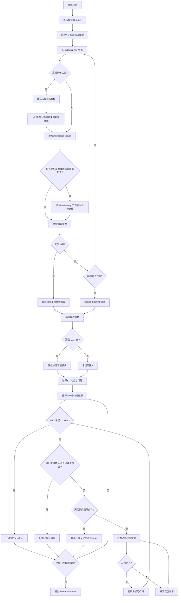

# 问题4机器狗自动搜索、定位与清除程序说明

> 对应程序：`problem4_robot_sparse_optimized(1).py`  
> 适用场景：2026 CUMCM B题问题4  
> 核心目标：在目标区域内同时存在**全向干扰源**与**180°定向干扰源**、且定向源朝向未知的情况下，尽可能降低机器狗的总移动距离与虚拟耗时，同时保持搜索完备性与定位/清除的保守正确性。

---

## 1. 程序概述

该程序将完整任务划分为两个主要阶段：

1. **阶段A：25点严格保证搜索 + 搜索/清除联合路线**
2. **阶段B：方向感知定位与清除**

程序并不是简单地“先搜索全部干扰源，再逐个定位”，而是在阶段A中动态把已经可以安全清除的干扰源插入剩余搜索路线，实现：

- 搜索与清除交织；
- 减少后续折返；
- 复用已经经过的位置进行额外测向；
- 在不破坏25点搜索完备性的前提下降低移动距离。

当完整搜索结束后，如果最终发现的干扰源数量为 **11～15个**，程序会额外启用“少干扰源专项模式”，使用：

- 跨频道同点顺测；
- Held–Karp 精确开放路径动态规划；

进一步减少阶段B的路线长度。

---

## 2. 问题中的关键参数

| 参数 | 数值 | 含义 |
|---|---:|---|
| `ARENA_R` | 1800 m | 目标区域半径 |
| `MIN_RECEIVE_R` | 1000 m | 保证接收到信号的距离尺度 |
| `MAX_RECEIVE_R` | 1500 m | 成功测向后用于约束源位置的最大接收距离 |
| `BEARING_ERR_DEG` | ±1° | 示向角测量误差 |
| `NEAR_R` | 5 m | 进入近距区后可直接清除 |
| `CLEAR_R` | 20 m | 清除有效半径 |
| `READY_RADIUS` | 19 m | MEC达到该半径后执行保守清除，留1 m余量 |
| `P4_INNER_R` | 950 m | 25点搜索网内环半径 |
| `P4_RING_N` | 12 | 内、外环点数 |
| `P4_PROBE_FORWARD` | 180 m | 定向追踪最大前向探测距离 |
| `P4_PROBE_LATERAL` | 30 m | 定向追踪最大侧向偏移 |
| `P4_CLEAR_GRID_STEP` | 26 m | 自适应清除网格最大单元边长 |
| `P4_CLEAR_GRID_MAX_POINTS` | 6 | 最多允许的局部保证清除点数 |
| `P4_SPARSE_MIN_SOURCES` | 11 | 少源模式下界 |
| `P4_SPARSE_MAX_SOURCES` | 15 | 少源模式上界 |
| `P4_SPARSE_DP_MAX_N` | 15 | 精确路径DP最大节点数 |

---

## 3. 总体算法流程



---

# 4. 阶段A：25点严格保证搜索

## 4.1 搜索点构造

搜索网共包含25个点：

- 中心点：1个；
- 半径950 m的内环：12个点；
- 外切目标圆的正12边形顶点：12个点。

外环半径为

\[
R_{\text{outer}}
=
\frac{1800}{\cos 15^\circ}.
\]

内环点按照每30°一个点布置，外环点相对内环旋转15°。

因此搜索区域可以被划分为：

- 12个“中心—内环—内环”三角形；
- 外侧每个30°扇区再划分成两个三角形。

---

## 4.2 为什么25点能够保证发现定向源

这是程序正确性的核心。

程序构造的三角剖分满足：

\[
\max_{\triangle} \{\text{三角形边长}\}<1000\text{ m}.
\]

假设真实干扰源 \(G\) 位于其中某个三角形内部。

因为三角形是凸集，且三个顶点之间的最大距离均小于1000 m，所以源点到该三角形三个顶点的距离均小于1000 m。

对于全向源，只要到达任意一个这样的顶点即可发现。

对于180°定向源，可以把有效覆盖区域理解为一个经过源点的半平面。

由于源点位于三个顶点的凸包内部，不可能存在一个经过源点的180°半平面，使三个顶点全部位于无效侧。

因此三个顶点中至少有一个同时满足：

1. 与源距离小于1000 m；
2. 位于定向源有效的180°覆盖半平面内。

于是该定向源必然会被25点搜索网中的至少一个搜索点发现。

程序还提供了离散验证函数：

```python
p4_discrete_directional_gap()
```

对目标圆内大量采样位置检查1000 m邻域内搜索点的最大方向角缺口，只要结果不超过180°，就说明搜索网与上述理论结论一致。

---

## 4.3 搜索频道优化

在每个搜索站，程序只扫描：

```text
尚未发现的频道
```

一旦某频道已经被发现，就不再作为“未知频道”重复扫描。

这样可以显著减少后期扫描次数。

但是，已发现频道仍可能被“机会式顺测”，因为额外一次测向可能显著缩小定位区域。

---

# 5. 搜索站同点顺测优化

## 5.1 核心思想

机器狗已经因为保证搜索到达某个搜索站时，移动成本已经发生。

因此在当前位置额外测量一个已发现频道，只需要承担：

- 一次 `measure`；
- 可能的一次频道切换；

而不增加额外移动距离。

如果这次测向能够替代后续一次180 m级别的专门定位移动，就可能节省大量虚拟时间。

---

## 5.2 顺测候选筛选

程序不会盲目测量所有已知频道，而是通过 `_opportunistic_score()` 估计收益。

主要考虑：

### 1. 当前可行域是否接近该搜索站

如果整个保守可行域都位于1000 m内：

```python
distance_safe = robust_receive(...)
```

则距离条件较安全。

### 2. 搜索站是否仍大概率处于定向覆盖侧

根据最近一次成功示向建立：

- 前向方向 \(u\)；
- 横向方向 \(v\)。

计算当前搜索站相对于最近成功点的：

- forward；
- lateral；
- displacement。

只有满足一定“前向锥形区域”的位置才优先尝试。

### 3. 预计几何收益

程序用当前MEC中心作为临时预测源位置，估计在当前位置成功测向后新的可行域：

\[
\text{relative gain}
=
1-\frac{R_{\text{new}}}{R_{\text{old}}}.
\]

如果预计缩小效果很小，则不进行额外测量。

如果一次顺测预计可以直接把MEC压缩到19 m以内，则会获得额外奖励。

---

# 6. 源位置的保守几何表示

每一个已发现频道对应一个：

```python
SourceState
```

其中最重要的成员为：

```text
poly
```

它表示真实干扰源当前可能存在的**保守凸多边形可行域**。

---

## 6.1 ±1°角楔约束

若机器狗在位置 \(S\) 测得方向角

\[
\theta,
\]

则真实源方向满足：

\[
\theta-1^\circ
\le
\arg(G-S)
\le
\theta+1^\circ.
\]

程序使用两个半平面裁剪，得到一个角楔。

具体实现：

```python
clip_wedge()
```

底层使用 Sutherland–Hodgman 半平面裁剪：

```python
clip_halfplane()
```

每次成功测向都将新的角楔与原可行域取交集。

---

## 6.2 近距下界

如果测量结果为 `direction` 而不是 `near`，说明真实距离大于5 m。

程序进一步加入线性保守约束：

\[
u\cdot(G-S)
\ge
5\cos1^\circ.
\]

其中 \(u\) 为测得方向对应的单位向量。

---

## 6.3 最大接收距离约束

成功获得信号后，真实源还必须满足：

\[
\|G-S\|\le1500.
\]

程序使用180边外接正多边形近似圆盘，并通过连续半平面裁剪完成：

```python
clip_disk_outer()
```

这里采用的是**外接近似**，因此不会错误排除真实源。

---

# 7. 最小包围圆 MEC

程序对当前可行域计算最小包围圆：

```python
minimum_enclosing_circle()
```

记最小包围圆圆心为 \(C\)，半径为 \(R\)。

如果：

\[
R\le19\text{ m},
\]

则真实源必定位于以 \(C\) 为圆心、19 m为半径的区域内。

因为清除半径为20 m，所以在 \(C\) 点执行：

```text
/clear
```

理论上即可保证命中，并额外保留约1 m数值安全余量。

---

# 8. 自适应局部保证清除

有些可行域虽然MEC半径仍大于19 m，但几何形状非常细长。

如果继续追求“MEC半径≤19 m”，可能需要额外多次测向。

因此程序增加：

```python
_oriented_clear_grid()
```

---

## 8.1 主轴方向

程序首先寻找可行多边形的一对最远顶点，把两点连线作为主轴 \(u\)。

再构造垂直方向 \(v\)。

把多边形投影到 \(u,v\) 坐标系后得到一个旋转包围矩形。

---

## 8.2 网格保证

网格最大单元边长：

\[
26\text{ m}.
\]

如果把清除点放在每个网格单元中心，则任意单元内的点到中心最大距离不超过：

\[
\frac{26}{\sqrt2}
\approx18.385\text{ m}
<20\text{ m}.
\]

因此只要遍历所有网格中心，就可以保证覆盖整个包围矩形，从而保证覆盖真实源。

如果所需清除点数量：

\[
N_{\text{grid}}\le6,
\]

程序直接采用局部保证清除。

对于角楔交会后形成的细长区域，通常只需要2～4个点，因此往往比继续多次测向更快。

---

# 9. 最小二乘交会点试探清除

当已经获得至少两次成功示向时，可以利用多条示向中心线估计源位置。

程序采用最小二乘方法：

\[
\min_x
\sum_i
\left(n_i^\top(x-p_i)\right)^2,
\]

其中：

- \(p_i\)：第 \(i\) 次测向位置；
- \(n_i\)：对应示向直线的法向量。

求得统计交会点后，程序只在以下条件满足时尝试清除：

- 至少有2次观测；
- MEC半径不超过70 m；
- 最小二乘估计点没有明显偏离当前保守MEC。

注意：

**该最小二乘位置只用于优化，不用于缩小保守可行域。**

因此即使试探清除失败，也不会破坏定位正确性。

---

# 10. 阶段A中的搜索/清除联合路线

传统方案通常是：

```text
完成25点搜索
→ 再返回各干扰源
→ 定位和清除
```

这会产生较大的折返距离。

本程序将三类节点统一加入路线规划：

```text
search：尚未访问的保证搜索点
clear ：已经READY，可直接清除的源
sweep ：可用少量网格点保证清除的源
```

---

## 10.1 路线优化

初始路线采用：

```text
Nearest Neighbor
+
2-opt
```

并通过多个不同的首节点生成多个候选解：

```python
P4_ROUTE_MULTISTART = 10
```

从而降低单一最近邻初始解陷入较差局部最优的概率。

---

## 10.2 Future软引导

对尚未READY、但已经有至少两次观测的源，程序计算最小二乘交会位置。

这些位置不作为必须访问的节点，而仅用于评价路线是否“顺便靠近未来可能需要处理的位置”。

路线评分大致为：

\[
J
=
L_{\text{route}}
+
\lambda
\sum_i
d(q_i,\text{route}),
\]

其中：

- \(L_{\text{route}}\)：实际路线长度；
- \(q_i\)：未完成源的统计预测位置；
- \(d(q_i,\text{route})\)：预测位置到路线折线的距离；
- \(\lambda\)：软引导权重。

为了避免统计预测导致严重绕路，程序还有硬保护：

```python
P4_MIXED_ROUTE_MAX_EXTRA_M = 120
```

如果软引导路线比同一候选集合中的纯距离最短路线多走超过120 m，就直接退回纯距离路线。

---

# 11. 阶段B：方向感知定位

阶段A结束后，仍未清除的干扰源进入阶段B。

对于每个待处理源，程序依次判断：

```text
MEC <= 19 m
    ↓ 否
能否用 <= 6 个网格点保证清除
    ↓ 否
是否满足最小二乘试探清除
    ↓ 否
执行左右对称定向探测
```

---

# 12. 左右对称定向探测

这是定向源定位的核心。

程序不会假设：

```text
距离源小于1000 m就一定能够收到定向源信号
```

因为定向源可能朝向相反方向。

因此每次从**最近一次成功测向位置**继续探测。

---

## 12.1 局部坐标系

最近一次成功测向角为 \(\theta\)。

定义：

\[
u=(\cos\theta,\sin\theta)
\]

作为前向单位向量，

\[
v=(-\sin\theta,\cos\theta)
\]

作为横向单位向量。

---

## 12.2 自适应前进距离

程序根据当前MEC中心估计源在前向方向上的距离：

\[
d_f
=
u^\top(C-S).
\]

前进距离不是固定180 m，而是：

\[
f_0
=
\min
\left(
180,
\max(40,0.55d_f)
\right).
\]

这样做可以：

- 源较远时保持较大步长；
- 接近源时自动缩小步长；
- 减少直接越过真实源后进入定向无信号区域的概率。

---

## 12.3 横向偏移

横向距离采用：

\[
b_0
=
\min
\left(
30,
\max(12,0.18f_0)
\right).
\]

构造两个候选点：

\[
Q_+
=
S+fu+bv,
\]

\[
Q_-
=
S+fu-bv.
\]

左右两个点既能产生新的交会基线，又避免使用过大的侧向移动。

---

## 12.4 双侧失败缩步

如果左右两个候选点均返回：

```text
no_signal
```

则：

\[
\text{scale}
\leftarrow
\frac12\text{scale}.
\]

然后重新构造更靠近最近成功点的左右探测位置。

最小尺度：

\[
\frac1{64}.
\]

如果极小尺度仍然没有信号，程序会回到最近一次成功位置重新测量，用于检查状态一致性。

---

# 13. 少干扰源专项模式

## 13.1 启用条件

只有在25点保证搜索已经完整结束后，程序才知道真实发现源数。

若：

\[
11\le N_{\text{source}}\le15,
\]

则开启：

```text
sparse_mode
```

16源场景不会因为“疑似少源”而提前改变搜索逻辑，因此不会破坏原本的搜索完备性。

---

## 13.2 跨频道同点顺测

在阶段B中，机器狗每到达一个：

- probe点；
- clear点；
- sweep点；

都可能顺便测量其他未完成频道。

最多选取：

```python
P4_SPARSE_CROSS_MAX_PER_STOP = 2
```

个高收益频道。

为了避免大量低收益测量，要求：

- 预计一次即可READY；或者
- `score` 与 `relative_gain` 同时超过更严格阈值。

同时对相近位置做去重，避免在15 m以内重复尝试同一频道。

---

# 14. 少源模式的精确开放路径DP

常规阶段B使用：

```text
多起点最近邻 + 2-opt
```

规划剩余源的处理顺序。

当少源模式开启，并且剩余节点数：

\[
n\le15,
\]

程序改用 Held–Karp 动态规划求：

```text
固定起点、终点自由的最短开放Hamilton路径
```

---

## 14.1 状态定义

令：

\[
dp[mask][j]
\]

表示：

从机器狗当前位置出发，已经访问集合 `mask` 中的节点，并且最后停在节点 \(j\) 的最短路径长度。

初始化：

\[
dp[2^j][j]
=
d(S,j).
\]

状态转移：

\[
dp[mask\cup\{k\}][k]
=
\min_{j\in mask}
\left(
dp[mask][j]+d(j,k)
\right).
\]

最终不要求回到起点，因此：

\[
\min_j dp[\text{full}][j]
\]

即为最优开放路径。

---

## 14.2 复杂度

Held–Karp算法时间复杂度为：

\[
O(n^2 2^n),
\]

空间复杂度为：

\[
O(n2^n).
\]

虽然指数级，但程序只在：

\[
n\le15
\]

时启用，因此规模仍然可控。

而且每处理完一个源后，节点位置和剩余任务都会变化，程序会重新规划，使下一步选择始终基于最新状态。

---

# 15. 下一源的选择方式

阶段B不是简单选择“当前距离最近的源”。

对于每一个未清除源，程序先构造它的**下一实际动作点**：

1. 已READY  
   → MEC中心；

2. 可局部网格清除  
   → 网格路线的第一个点；

3. 需要继续定位  
   → 最近的成对探测候选点；

4. 特殊情况  
   → 最近一次成功观测位置。

然后对这些“下一动作点”统一做路线规划。

因此优化目标更接近：

```text
下一步真正需要去哪里
```

而不是：

```text
哪个源的估计中心离我最近
```

---

# 16. HTTP通信与日志

## 16.1 接口

程序使用四个主要接口：

```text
/enter
/measure
/clear
/exit
```

通信全程串行执行。

---

## 16.2 网络重试

如果发生：

- `URLError`
- socket超时
- `TimeoutError`
- `ConnectionError`

程序会自动重试。

关键设计是：

> 同一个动作重试时复用相同的 `request_id`。

这样可以降低网络响应丢失后重复执行动作的风险。

对于明显属于程序或参数错误的HTTP状态，例如：

```text
400 / 404 / 405 / 409 / 413 / 415
```

程序不会盲目重试。

---

## 16.3 JSONL日志

每次HTTP请求及异常都会写入：

```text
logs/problem4_YYYYMMDD_HHMMSS.jsonl
```

任务结束后还会生成：

```text
logs/problem4_YYYYMMDD_HHMMSS_summary.json
```

便于后续统计虚拟时间和分析性能瓶颈。

---

# 17. 输出统计指标

`summary()` 中包含以下主要数据。

## 搜索结果

```text
found_channels
found_count
empty_channels
cleared_channels
cleared_count
clear_rate_vs_found
```

## 搜索策略

```text
search_points
mesh_max_edge_m
fixed_route_length_m
```

## 定位优化统计

```text
no_signal_probe_count
interleaved_clear_count
trial_clear_count
trial_clear_success_count
sparse_mode
sparse_cross_measure_count
sparse_cross_hit_count
sparse_cross_no_signal_count
sparse_route_dp_count
mixed_route_guard_count
```

## 路线与动作统计

```text
move_distance_m
estimated_move_time_s
measure_count
channel_switch_count
clear_count
clear_success_count
clear_fail_count
```

其中估计移动时间为：

\[
T_{\text{move}}
=
\frac{D_{\text{move}}}{5}.
\]

这些统计可以直接用于比较不同优化版本的实际效果。

---

# 18. 本地自检

运行：

```powershell
python "problem4_robot_sparse_optimized(1).py" --self-test
```

自检主要验证：

### 1. 25点数量

必须满足：

```text
25 points
```

### 2. 三角网最大边长

要求：

\[
L_{\max}<1000\text{ m}.
\]

### 3. 定向覆盖角缺口

离散验证要求：

\[
\text{maximum angular gap}\le180^\circ.
\]

### 4. 角楔交会

验证多次测向后可行域：

- 非空；
- 直径有限；
- MEC计算正常。

### 5. 成对探测尺度

检查最大探测位移不会过大。

---

# 19. 正式运行方式

首先在模拟器中：

1. 登录；
2. 启动“问题4演练测试”或“问题4正式测试”；
3. 等待接口显示就绪。

然后执行：

```powershell
python "problem4_robot_sparse_optimized(1).py" --robot-id "你的参赛队号"
```

也可以通过环境变量设置：

```powershell
$env:ROBOT_ID="你的参赛队号"
python "problem4_robot_sparse_optimized(1).py"
```

如果模拟器地址不是默认的：

```text
http://127.0.0.1:2026
```

可以使用：

```powershell
python "problem4_robot_sparse_optimized(1).py" `
    --robot-id "你的参赛队号" `
    --base-url "http://127.0.0.1:2026"
```

指定日志目录：

```powershell
python "problem4_robot_sparse_optimized(1).py" `
    --robot-id "你的参赛队号" `
    --log-dir "logs"
```

---

# 20. 程序中的正确性与性能优化分层

这份程序的一个重要设计思想是：

> **严格保证逻辑和经验优化逻辑分离。**

## 保证正确性的部分

包括：

- 25点三角剖分保证搜索；
- ±1°角楔交会；
- 最大接收距离外接约束；
- MEC半径≤19 m的保证清除；
- 26 m网格的20 m覆盖保证；
- 未达到16源时必须完成25点后才能判空。

这些部分决定算法是否“可靠”。

---

## 只用于性能优化的部分

包括：

- 最小二乘交会点；
- future预测位置；
- 搜索站同点顺测收益评分；
- trial clear；
- mixed-route软引导；
- 多起点2-opt；
- 少源跨频道顺测。

这些信息即使预测错误，也不会直接改变真实源的保守可行域。

因此优化失败通常只会影响运行时间，而不会直接破坏几何定位的正确性。

---

# 21. 主要时间开销

该程序的CPU几何计算规模很小，实际比赛中的耗时主要来自：

1. **机器狗移动距离**
2. `measure`次数
3. 频道切换
4. `clear`次数
5. 因定向源无信号导致的无效probe

因此程序的大部分优化都围绕：

```text
减少移动
>
复用已经到达的位置
>
减少无效probe
>
减少不必要measure
```

展开。

---

# 22. 主要算法复杂度

设当前可行多边形顶点数为 \(V\)，剩余路线节点数为 \(n\)。

### 半平面裁剪

一次裁剪：

\[
O(V).
\]

### 多边形直径

当前实现枚举顶点对：

\[
O(V^2).
\]

由于实际可行域顶点数量较少，因此开销很小。

### 最近邻路线

\[
O(n^2).
\]

### 2-opt

节点规模不大，主要作为启发式局部优化使用。

### 少源Held–Karp DP

\[
O(n^2 2^n),
\]

空间：

\[
O(n2^n),
\]

且仅在：

\[
n\le15
\]

时执行。

总体而言，程序性能瓶颈主要不是Python计算量，而是模拟器中的动作成本。

---

# 23. 代码模块结构

```text
基础几何
├── add / sub / mul
├── dot / cross / dist
├── clip_halfplane
├── clip_wedge
├── clip_disk_outer
└── polygon_diameter

最小包围圆
├── Circle
├── circle_two
├── circle_three
└── minimum_enclosing_circle

干扰源状态
├── Observation
└── SourceState

25点保证搜索
├── p4_guarantee_search_points
├── p4_search_route
├── p4_mesh_max_edge
└── p4_discrete_directional_gap

通信
└── SimulatorClient
    ├── enter
    ├── measure
    ├── clear
    └── exit

主控制器
└── Problem4Controller
    ├── guaranteed_directional_search
    ├── opportunistic_known_at_search_station
    ├── sparse_opportunistic_known_at_current_position
    ├── try_clear_source
    ├── try_local_clear_sweep
    ├── _maybe_trial_clear
    ├── _plan_mixed_route
    ├── _exact_open_route_dp
    ├── localize_one_source
    ├── localize_and_clear_all
    └── summary
```

---

# 24. 核心优化总结

与基础的“固定搜索 + 逐源定位”方案相比，本程序主要加入了以下优化：

1. **25点严格定向保证搜索**
2. **搜索和清除联合规划**
3. **搜索站零移动成本同点顺测**
4. **根据几何收益筛选机会测量**
5. **MEC达到19 m后直接保证清除**
6. **细长可行域使用定向网格提前保证清除**
7. **最小二乘交会点廉价试探清除**
8. **方向感知的左右对称探测**
9. **双侧无信号后自动减半步长**
10. **前进和横向距离随可行域自动缩短**
11. **future位置只作为路线软引导**
12. **120 m硬绕路保护**
13. **11～15源启用少源专项模式**
14. **阶段B跨频道同点复用**
15. **少源情况下使用Held–Karp精确开放路径DP**

这些优化共同作用，使程序在保持搜索与定位安全性的同时，重点减少：

- 搜索结束后的大范围折返；
- 定向源定位中的无效移动；
- 已到达位置的浪费；
- 少干扰源情况下逐源最近邻造成的长距离跳转。

---

# 25. 一句话概括

该程序可以概括为：

> **用25点三角网保证所有全向/180°定向源必被发现，用±1°角楔维护保守可行域，用MEC和自适应清除网格决定何时安全清除，再通过搜索/清除混合路线、同点顺测、方向感知探测以及少源Held–Karp路径规划尽量降低总虚拟时间。**
